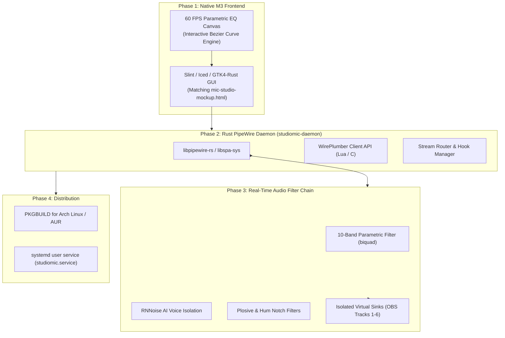

# StudioMic: Antigravity Client Handover & Implementation Guide

> **Target Platform:** Omarchy / Arch-based Linux  
> **Audio Subsystem:** PipeWire & WirePlumber  
> **UI Design Standard:** Google Material Design 3 (Material You) + Google Material Symbols  
> **Feature Target:** 100% Feature Parity & Superiority over **Shure MOTIV Mix** (Windows/macOS)

---

## 1. Project Mission & Context

**StudioMic** is an open-source, native Linux microphone tuning and multi-source virtual mixing suite. Its mission is to bring professional broadcast microphone processing and multi-channel streaming audio management to Linux users (specifically Arch Linux and the Omarchy distribution), matching and exceeding the workflow of Shure's proprietary **MOTIV Mix** software.

### The Problem on Linux
- Shure MOTIV Mix, Elgato Wave Link, and SteelSeries Sonar are exclusive to Windows and macOS.
- Existing Linux tools (EasyEffects, Carla, Helvum, qpwgraph) are either modular routing patches or complex generic equalizer racks lacking an integrated streaming workflow, automated soundcheck calibration, game hooking, or per-tab browser audio splitting.

### The Solution: StudioMic
A unified application offering:
1. **Verified Recommended Microphone EQ Profiles** for the top 20 streaming microphones.
2. **Interactive 10-Band Logarithmic Parametric EQ** with draggable nodes and scroll-wheel Q factor.
3. **Multi-Source Virtual Mixer & OBS Routing Matrix** with renamable channels, dedicated game PID tracking, and per-tab browser sub-stream isolation.
4. **Real-Time Acoustic Noise Cancellation** (RNNoise AI isolation, digital de-popper, 60Hz hum notch, keyboard gate).
5. **VoiceMatch Soundcheck & Acoustic Calibration** with before/after gain measurement and on-screen gain reduction trimming.

---

## 2. Inventory of Package Files

This folder contains the complete architectural specification, the validated interactive prototype, and this handover guide:

| File | Purpose | Description |
| :--- | :--- | :--- |
| `concept-spec.md` | **Architectural Specification** | Comprehensive technical blueprints, PipeWire node designs, WirePlumber rules, MOTIV Mix parity matrix, 20-microphone database, and filter parameters. |
| `mic-studio-mockup.html` | **Interactive Prototype** | Standalone HTML5/Tailwind/Canvas mockup demonstrating full UI interactivity, 60fps logarithmic EQ canvas, mixer faders, modals, and brand-sorted mics. |
| `AGENT_INSTRUCTIONS.md` | **Handover Documentation** | This document. Guidance for any subsequent Antigravity client to understand past decisions and continue implementation. |
| `README.md` | **Quickstart & Overview** | Overview for humans and developers viewing the Google Drive folder. |

---

## 3. Core Architectural Rules & Past Alignment Decisions

When continuing work on this project, the following design decisions and user requirements **must be maintained**:

### 3.1 Design System & Iconography
- **Google Material Design 3 (Material You):** Standard M3 surface hierarchy (`surface-container-lowest` to `surface-container-highest`), full rounded tokens (`rounded-[28px]`, `rounded-[32px]`), and tone palettes.
- **Google Material Symbols Only:** Strictly use official Google Material Symbols ligatures (`https://fonts.google.com/icons`) loaded from Google Fonts. **Do not use miscellaneous Unicode emojis** (e.g. no 🎙️, 🎮, 💬, 🎵, 💾, 🎯).
- **No Rating Badges or Third-Party Mentions:** Profiles must be labelled **"Recommended EQ for [Microphone Name]"** rather than star ratings or Reddit references.
- **Clean Active Input Microphone Header:** The top active hardware input card remains focused exclusively on hardware device selection (clean brand-sorted dropdown), connection/buffer telemetry, and live VU level metering. All EQ curves, industry target presets, and manual controls are housed inside the Microphone EQ Studio workstation below rather than displaying a redundant "Recommended EQ" badge on the hardware header.

### 3.2 Microphone Database (Top 20 Streaming Models)
All 20 microphones are arranged alphabetically by **Brand** with clean names (no extra parenthetical tags):
- **Audio-Technica:** Audio-Technica AT2020
- **BEACN:** BEACN Mic
- **Blue / Logitech G:** Blue Yeti, Logitech G Yeti GX, Logitech G Yeti Orb
- **Elgato:** Elgato Wave DX, Elgato Wave:3
- **FIFINE:** FIFINE AmpliGame AM8
- **HyperX:** HyperX QuadCast 2 S, HyperX SoloCast 2
- **NZXT:** NZXT Capsule Elite
- **Razer:** Razer Seiren V3 Pro
- **Rode:** Rode PodMic, Rode PodMic USB, Rode NT-USB+
- **Sennheiser:** Sennheiser Profile
- **Shure:** Shure SM7B, Shure MV7+, Shure MV6
- **SteelSeries:** SteelSeries Alias, SteelSeries Alias Pro
- **Universal:** Generic Microphone

### 3.3 Mixer Channel Strip Architecture
- **Channel 1 (Locked Microphone Channel):** Cannot be arbitrarily renamed. Dynamically reflects the **active microphone hardware model** (e.g., `FIFINE AmpliGame AM8`) and the **currently applied EQ profile** (e.g., `Recommended EQ for Fifine AM8`).
- **Channels 2+ (Renamable Virtual Mixes):** Feature inline rename capability (clicking the title or the `edit` icon triggers an inline input with `Enter` to commit, `Escape` to cancel).
- **Channel 2 (Game Audio):** Surfaces the exact **currently hooked game** (e.g. `Counter-Strike 2`), its live Process ID (`PID: 4892`), and PipeWire node ID (`Node #89`). Supports Auto-Hook Active Window.
- **Channel 3 (Discord Voice):** Automatically hooks communication clients (`Discord`, `Vesktop`, `TeamSpeak`, `Mumble`).
- **Channel 4 (Music / VOD Shield):** Excluded from OBS Twitch VOD Track 2 to prevent copyright strikes. Features dual-dropdown application & per-tab sub-routing.
- **Dual-Tier Browser Sub-Routing:** Allows isolating specific browser tabs (e.g. Zen Browser or Chrome playing YouTube Music or Twitch) onto their own dedicated fader via PipeWire `media.name` / `media.title`.
- **Add / Remove Channels:** Users can add custom virtual buses (`+ Add Virtual Mix`) or delete unneeded channels with one click.

### 3.4 VoiceMatch Soundcheck & Calibration
- Provides automated 5-second acoustic measurement.
- Displays **Before Gain** (pre-calibration level, e.g. `+12.0 dB`) vs. **After Calibrated Gain** (target broadcast level, e.g. `+24.5 dB`).
- Features an on-screen **Gain Reduction / Trim Slider** right on the results panel to reduce sensitivity if the room has ambient noise.
- Allows saving the tailored profile directly to the user's custom library.

### 3.5 10-Band EQ Default Architecture & Dynamic Band Controls (Max 10 Bands)
- **10 Bands by Default:** All factory microphone presets (`micData`), community presets (`broadcast`, `streamer`, `dialogue`), and the manual reset curve default to **10 parametric bands**.
- **Plus / Minus Controls (`+` and `-`):**
  - **`[+] Add Band`:** Adds a new parametric EQ band at an open frequency anchor. Capped at a **strict maximum of 10 bands**. When the 10-band ceiling is reached, the button automatically disables (`opacity-50 cursor-not-allowed`).
  - **`[-] Remove`:** Pops the trailing band down to a minimum of 1 band.
  - **Per-Row Delete Action:** Individual table rows include a trash delete button (`delete`) for surgical removal of any specific band.
  - **Active Band Badge:** Displays `X Bands Active (Max 10)` in real time.
- **Auto-Sorting & Dynamic Canvas Labels:** Bands are sorted chronologically by frequency (`a.freq - b.freq`) upon dragging or manual editing, ensuring nodes `B1` through `B10` remain consistently ordered from left to right on the 60 FPS interactive HTML5 canvas.

---

## 4. Implementation Roadmap for the Next Antigravity Client

The conceptual and interactive design phases are complete. The next phase is implementing the native Linux application:



### Detailed Execution Steps:
1. **Initialize the Rust Project:**
   ```bash
   cargo new studiomic --bin
   cd studiomic
   cargo add pipewire libspa slint tokio serde serde_json
   ```
2. **Implement PipeWire Filter-Chain Config Generator:**
   - Translate `micData` curves into PipeWire `filter-chain` JSON/SPA configs using standard biquad filters (`builtin/biquad`).
3. **Build the WirePlumber Hook Watcher:**
   - Monitor `client.name`, `application.name`, and `media.name` using WirePlumber's registry to implement dynamic Game Hooking and Browser Per-Tab Isolation.
4. **Implement UI in Slint / GTK4-Rust:**
   - Use the layout, spacing, and Material Symbols ligature icons established in `mic-studio-mockup.html`.
5. **Package for Omarchy / Arch:**
   - Create a clean `PKGBUILD` with `studiomic.service` systemd unit and desktop integration.

---

## 5. Verification Commands

To verify the interactive prototype and specifications:
```bash
# Validate HTML syntax and ensure zero stray emojis remain:
python3 -c "
from html.parser import HTMLParser
with open('mic-studio-mockup.html', 'r', encoding='utf-8') as f:
    HTMLParser().feed(f.read())
print('HTML syntax is 100% valid!')
"

# Open the prototype in any Linux browser:
xdg-open mic-studio-mockup.html
```

---

## 6. Google Drive Package & Archive Drop-off

To facilitate easy drop-off to Google Drive for sharing across machines or with other Antigravity agents:
- The entire workspace is bundled into **`StudioMic-Package.zip`** located in the workspace root:
  - Path: `/home/ramone/EQ/StudioMic-Package.zip`
  - Backup copy: `/home/ramone/StudioMic-Package.zip`
- The zip contains:
  1. `mic-studio-mockup.html` (Complete interactive prototype with 10-band EQ canvas & mixer)
  2. `concept-spec.md` (Complete architectural & PipeWire specification)
  3. `AGENT_INSTRUCTIONS.md` (This document)
  4. `README.md` (Quickstart package documentation)
- Simply drag and drop `StudioMic-Package.zip` directly into your Google Drive folder. To unpack on another machine:
  ```bash
  unzip StudioMic-Package.zip -d StudioMic/
  ```
