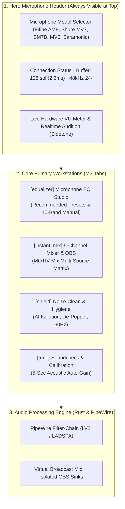

# StudioMic Linux (MOTIV Mix Linux Edition)
### Architectural Specification & Layout Blueprint (v3)

---

## 1. Top-Level Layout Hierarchy (User-First Flow)

The application adheres strictly to the **Google Material Design 3 (Material You)** philosophy:
1. **Immediate Hardware Awareness:** The currently selected physical microphone is crowned **above everything else at the top of the interface**. It is the very first component rendered, allowing instant hardware switching and status checks without hunting through mixer channels.
2. **Prominent Dedicated EQ Studio:** Equalization is treated as a primary, first-class workstation—featuring verified **online community presets** tailored to each microphone's acoustic flaws, accompanied by a **10-band manual parametric mode**.
3. **Multi-Channel Mixer Below:** The 5-channel virtual audio matrix (Game, Discord, Spotify VOD Shield, Alerts) sits below the microphone processor, providing seamless OBS stream isolation.

---

## 2. Microphone Database & Recommended EQ Profiles (Arranged by Brand)

Each popular streaming microphone has documented capsule physics and acoustic idiosyncrasies. StudioMic ships with tested, recommended tuning profiles alongside full manual overrides, arranged alphabetically by hardware brand:

| Brand | Microphone | Connectivity | Acoustic Profile & Weaknesses | Recommended EQ Profile | Target Parametric EQ Parameters |
| :--- | :--- | :--- | :--- | :--- | :--- |
| **Audio-Technica** | **Audio-Technica AT2020** | XLR | Studio condenser staple; flat translation; lean lower body and sharp presence peak at 5.8kHz. | **"Recommended EQ for Audio-Technica AT2020"** Supplements chest warmth and softens high-frequency presence bite. | • HPF: 80 Hz (18dB/oct) • Warmth Boost: +1.8 dB @ 160 Hz (Q=1.0) • Peak Softener: -2.2 dB @ 5.8 kHz (Q=2.0) • De-Ess: -2.5 dB @ 8.2 kHz (Q=2.5) • Studio Air: +1.8 dB @ 12 kHz (High Shelf) |
| **BEACN** | **BEACN Mic** | USB-C | Dynamic capsule with hardware DSP compressor/limiter; proximity boom when close; needs air lift at 11kHz. | **"Recommended EQ for BEACN Mic"** Balances proximity boom; refines broadcast sheen and presence. | • HPF: 80 Hz (18dB/oct) • Proximity: -2.5 dB @ 210 Hz (Q=1.3) • Presence: +2.2 dB @ 3.5 kHz (Q=1.4) • De-Ess: -2.0 dB @ 6.5 kHz (Q=3.0) • Sheen: +3.0 dB @ 11 kHz (High Shelf) |
| **Blue / Logitech G** | **Blue Yeti** | USB | Four polar patterns; simple plug-and-play; highly sensitive to room echo, hollow 220Hz mud, and harsh 6.5kHz sizzle. | **"Recommended EQ for Blue Yeti"** Notches room rumble and harsh condenser sizzle; focuses mid vocal core. | • HPF: 90 Hz (24dB/oct) • Mud Notch: -3.0 dB @ 220 Hz (Q=1.2) • Dialogue Core: +1.8 dB @ 2.6 kHz (Q=1.3) • De-Sizzle: -3.2 dB @ 6.5 kHz (Q=2.6) • Treble Roll: -1.5 dB @ 12.5 kHz (High Shelf) |
| **Blue / Logitech G** | **Logitech G Yeti GX** | USB-C | Supercardioid capsule with downward expander; key-click rejection; nasal low-mids and sharp 7.2kHz. | **"Recommended EQ for Logitech G Yeti GX"** Removes boxy nasal resonance; smooths high clicks. | • HPF: 85 Hz (18dB/oct) • Nasal Cut: -2.8 dB @ 320 Hz (Q=1.5) • Speech Clarity: +2.0 dB @ 2.9 kHz (Q=1.4) • Click Tamer: -2.2 dB @ 7.2 kHz (Q=2.5) • Air Gloss: +2.0 dB @ 11.5 kHz (High Shelf) |
| **Blue / Logitech G** | **Logitech G Yeti Orb** | USB-C | Compact sphere design; entry-level capture; hollow boxiness at 380Hz; needs clarity over game sound. | **"Recommended EQ for Logitech G Yeti Orb"** Notches hollow room boxiness and boosts vocal intelligibility. | • HPF: 95 Hz (24dB/oct) • Boxy Cut: -3.0 dB @ 380 Hz (Q=1.5) • Intelligibility: +2.5 dB @ 2.6 kHz (Q=1.4) • Treble Smooth: -2.0 dB @ 7.0 kHz (Q=2.5) |
| **Elgato** | **Elgato Wave DX** | XLR | Sleek broadcast body; zero-phantom power; needs warmth reinforcement at 1.4kHz and presence polish at 4.2kHz. | **"Recommended EQ for Elgato Wave DX"** Brings natural spoken-word warmth and crisp articulation. | • HPF: 75 Hz (12dB/oct) • Proximity: -2.0 dB @ 250 Hz (Q=1.1) • Body: +1.8 dB @ 1.4 kHz (Q=1.2) • Articulation: +3.0 dB @ 4.2 kHz (Q=1.4) • Air: +2.2 dB @ 12 kHz (High Shelf) |
| **Elgato** | **Elgato Wave:3** | USB-C | High-sensitivity condenser with Clipguard 2.0; crisp and bright; prone to sibilance spike at 6.8kHz. | **"Recommended EQ for Elgato Wave:3"** Re-injects chest body while surgically taming upper sibilance sizzle. | • HPF: 95 Hz (24dB/oct) • Chest Body: +1.5 dB @ 170 Hz (Q=1.1) • Definition: +1.8 dB @ 3.2 kHz (Q=1.4) • Sizzle Cut: -3.5 dB @ 6.8 kHz (Q=2.4) • Smooth Air: -1.0 dB @ 13.5 kHz (High Shelf) |
| **FIFINE** | **FIFINE AmpliGame AM8** | USB-C / XLR | Top budget entry; boomy proximity effect; capsule boxiness at 280Hz; brittle sibilance at 7.1kHz. | **"Recommended EQ for Fifine AM8"** Scuffs out low-mid mud, pushes vocal bite, smooths sibilance. | • HPF: 85 Hz (18dB/oct) • Mud Cut: -3.5 dB @ 280 Hz (Q=1.4) • Clarity: +2.0 dB @ 2.4 kHz (Q=1.6) • De-Ess: -2.8 dB @ 7.1 kHz (Q=3.2) • Air: +2.0 dB @ 11 kHz (High Shelf) |
| **HyperX** | **HyperX QuadCast 2 S** | USB-C | 192kHz/32-bit high-res condenser with aRGB; sensitive to keyboard noise and high-frequency sizzle at 7.5kHz. | **"Recommended EQ for HyperX QuadCast 2 S"** Cuts desk resonance; pushes voice intelligibility over game sound. | • HPF: 95 Hz (24dB/oct) • Desk Rumble: -2.5 dB @ 240 Hz (Q=1.3) • Vocal Presence: +2.0 dB @ 3.3 kHz (Q=1.5) • Click De-Harsh: -3.0 dB @ 7.5 kHz (Q=2.8) • Gentle Air: +1.5 dB @ 12 kHz (High Shelf) |
| **HyperX** | **HyperX SoloCast 2** | USB-C | Ultra-compact profile; 24-bit/96kHz capture; highly sensitive to desk keyboard knocks and sharp top end. | **"Recommended EQ for HyperX SoloCast 2"** Steep high-pass filter; cuts desk knocks and softens click resonance. | • HPF: 100 Hz (24dB/oct) • Desk Thump Cut: -3.5 dB @ 250 Hz (Q=1.8) • Vocal Clarity: +2.0 dB @ 3.0 kHz (Q=1.3) • Click Softener: -2.5 dB @ 7.8 kHz (Q=2.5) |
| **NZXT** | **NZXT Capsule Elite** | USB-C | Gaming cardioid condenser tuned to reject keyboard clatter; mid-range scoop needs filling. | **"Recommended EQ for NZXT Capsule Elite"** Fills mid-range dip and smooths mechanical click harmonics. | • HPF: 90 Hz (18dB/oct) • Mid Fill: +2.0 dB @ 1.8 kHz (Q=1.4) • Speech Cut: +2.5 dB @ 4.0 kHz (Q=1.5) • Click Harmonics: -2.2 dB @ 7.5 kHz (Q=2.5) • Air: +1.5 dB @ 12 kHz (High Shelf) |
| **Razer** | **Razer Seiren V3 Pro** | USB-C | Broadcast-ready condenser; aggressive gaming vocal presence; sensitive to desk boundary reflections at 340Hz. | **"Recommended EQ for Razer Seiren V3 Pro"** Mitigates desk boundary reflections and softens sharp treble bite. | • HPF: 90 Hz (24dB/oct) • Reflection Cut: -2.8 dB @ 340 Hz (Q=1.6) • Warmth: +1.2 dB @ 180 Hz (Q=1.2) • Bite Reduction: -3.0 dB @ 6.2 kHz (Q=2.2) • Air: +1.8 dB @ 11.5 kHz (High Shelf) |
| **Rode** | **Rode PodMic** | XLR | All-metal dynamic broadcast mic; heavy acoustic weight; thick low-mid proximity mud at 220Hz; needs high-end air boost to open up dark capsule. | **"Recommended EQ for Rode PodMic"** De-booms low-mid chestiness, enhances dialogue speech intelligibility, and opens top-end broadcast sheen. | • HPF: 80 Hz (18dB/oct) • Sub Mud Cut: -3.0 dB @ 220 Hz (Q=1.3) • Chest Warmth: +1.2 dB @ 1.2 kHz (Q=1.0) • Vocal Bite: +2.8 dB @ 3.5 kHz (Q=1.4) • Air Sheen: +3.0 dB @ 11.5 kHz (High Shelf) |
| **Rode** | **Rode PodMic USB** | USB-C / XLR | Heavy-duty build with internal pop protection and APHEX DSP; thick low-end proximity boom and harsh 3.8kHz forward edge. | **"Recommended EQ for Rode PodMic USB"** Sculpts low-end clarity, warms chest, and smooths harsh upper edge. | • HPF: 80 Hz (18dB/oct) • De-Boom: -3.2 dB @ 200 Hz (Q=1.2) • Chest Warmth: +1.5 dB @ 1.2 kHz (Q=1.0) • De-Harsh: -2.5 dB @ 3.8 kHz (Q=2.2) • Sheen: +2.8 dB @ 10.5 kHz (High Shelf) |
| **Rode** | **Rode NT-USB+** | USB-C | Studio-grade condenser with ultra-low noise preamp; detailed high end prone to plosives and bright sibilance. | **"Recommended EQ for Rode NT-USB+"** Controls plosive air bursts and polishes vocal presence smoothly. | • HPF: 85 Hz (18dB/oct) • Plosive Control: -2.5 dB @ 190 Hz (Q=1.3) • Speech Clarity: +1.8 dB @ 2.8 kHz (Q=1.4) • De-Ess: -3.0 dB @ 6.9 kHz (Q=3.0) • Smooth Air: +1.5 dB @ 11 kHz (High Shelf) |
| **Sennheiser** | **Sennheiser Profile** | USB-C | German-engineered capsule; naturally warm and balanced; slight low-mid chestiness at 280Hz. | **"Recommended EQ for Sennheiser Profile"** Cleans up low-mid boxiness and adds high-end broadcast sheen. | • HPF: 80 Hz (18dB/oct) • Boxiness Cut: -2.0 dB @ 280 Hz (Q=1.2) • Vocal Clarity: +2.0 dB @ 3.8 kHz (Q=1.3) • Sheen: +2.2 dB @ 10 kHz (High Shelf) |
| **Shure** | **Shure SM7B** | XLR | Industry standard broadcast tone; dark top end; low output requiring high gain; mid-forward boxiness. | **"Recommended EQ for Shure SM7B"** Opens up high air frequencies and eliminates sub-rumble. | • HPF: 80 Hz (18dB/oct) • Boxiness: -2.0 dB @ 240 Hz (Q=1.2) • Presence: +3.5 dB @ 4.2 kHz (Q=1.5) • Air Sheen: +4.0 dB @ 11.5 kHz (High Shelf) |
| **Shure** | **Shure MV7+** | USB-C / XLR | Hybrid dynamic capsule with touch panel and DSP; pronounced proximity chest boom; 6.2kHz bite. | **"Recommended EQ for Shure MV7+"** Tames the 220Hz chest boom while adding broadcast shine. | • HPF: 75 Hz (12dB/oct) • Proximity: -3.0 dB @ 220 Hz (Q=1.1) • Clarity: +2.5 dB @ 3.2 kHz (Q=1.3) • De-Harsh: -2.0 dB @ 6.2 kHz (Q=2.8) • Sheen: +3.0 dB @ 11 kHz (High Shelf) |
| **Shure** | **Shure MV6** | USB-C | Gaming dynamic; state-of-the-art auto-level mode; sensitive to desk bumps and plosives; hollow upper mids. | **"Recommended EQ for Shure MV6"** Low-cut desk thump filter; boosts speech intelligibility over game sound. | • HPF: 90 Hz (24dB/oct) • Desk Thump: -3.0 dB @ 450 Hz (Q=2.0) • Vocal Lift: +2.2 dB @ 2.8 kHz (Q=1.4) • Sparkle: +2.5 dB @ 10 kHz (High Shelf) |
| **SteelSeries** | **SteelSeries Alias** | USB | 3x larger condenser capsule area with LED mesh visualizer; deep low end prone to boominess; needs speech cut. | **"Recommended EQ for SteelSeries Alias"** De-booms large capsule proximity effect and sharpens speech articulation. | • HPF: 85 Hz (18dB/oct) • Proximity Boom: -3.0 dB @ 200 Hz (Q=1.2) • Articulation: +2.2 dB @ 3.4 kHz (Q=1.5) • Sibilance Notch: -2.5 dB @ 7.2 kHz (Q=2.7) • Polish: +2.0 dB @ 11 kHz (High Shelf) |
| **SteelSeries** | **SteelSeries Alias Pro** | XLR to USB | Large 1-inch dynamic capsule with Stream Mixer deck; warm broadcast voice with slight low-mid bloat at 260Hz. | **"Recommended EQ for SteelSeries Alias Pro"** Eliminates muddy bloat while emphasizing rich voice depth. | • HPF: 75 Hz (12dB/oct) • Mud Cut: -2.5 dB @ 260 Hz (Q=1.3) • Speech Clarity: +2.8 dB @ 3.6 kHz (Q=1.5) • Sibilance Smooth: -1.8 dB @ 7.2 kHz (Q=2.8) • Polish: +2.5 dB @ 11.5 kHz (High Shelf) |

---

## 3. Dual EQ Architecture: Community Preset vs. 10-Band Manual

### 3.1 Community Preset Mode
- **One-Click Verified Presets:** Sourced from broadcast engineering benchmarks and professional audio testing archives, pre-calibrated across a full 10-band profile.
- **Macro Character Sliders:**
  - *Warmth / Body* (120Hz – 250Hz tilt)
  - *Speech Presence* (2.5kHz – 4.5kHz clarity boost)
  - *Air & Sheen* (10kHz+ high shelf)

### 3.2 Full 10-Band Manual Parametric Mode (Default & Dynamic Bands)
- **10 Bands by Default:** All factory microphone presets and the manual equalizer load with 10 active parametric bands across the full audible spectrum (20Hz to 20kHz).
- **Dynamic Band Addition & Removal (`+` / `-` Controls):**
  - **Add Band (`[+] Add Band`):** Allows users to add additional parametric bands up to a **strict maximum cap of 10 bands**. When added, the engine automatically selects an unoccupied frequency anchor and keeps nodes sorted chronologically from left to right. Once 10 bands are active, the button gracefully enters a disabled state.
  - **Remove Band (`[-] Remove`):** Removes the trailing band down to a minimum of 1 band.
  - **Per-Row Delete Action:** Individual table rows feature a delete button (`delete`) to surgically remove specific bands.
  - **Active Band Badge:** Real-time badge display (e.g., `10 Bands Active (Max 10)`) indicating current filter capacity.
- **Interactive Drag-and-Drop Canvas:** 60 FPS real-time logarithmic frequency graph (20Hz to 20kHz, -18dB to +18dB) with draggable node dots (`B1` through `B10`) and mouse-wheel Q bandwidth adjustments.
- **Per-Band Precision Controls:**
  - Filter Type: High Pass (6, 12, 18, 24 dB/oct), Low Shelf, Peaking Bell, High Shelf, Notch.
  - Center Frequency (Hz) with fine-tuning step increments.
  - Gain (dB) in 0.1dB increments.
  - Q Factor (Bandwidth) from 0.1 (wide) to 14.0 (surgical notch).

---

## 4. Custom Profile Management System

StudioMic includes a comprehensive user profile engine:
- **Save Custom Profiles:** Save modified parametric curves, preamp gains, and noise gate thresholds with bespoke titles (e.g., *"Late Night Stream Warmth"*, *"Podcast Duo Host 1"*).
- **Profile Library & Management:**
  - One-click profile recall.
  - In-place renaming, cloning, and deletion.
  - Active profile comparison against baseline curves.
- **Cross-Platform Import & Export:**
  - Native StudioMic JSON (`.json`)
  - EasyEffects PipeWire preset (`.json`)
  - EqualizerAPO universal filter string (`.txt`)
  - Room EQ Wizard acoustic filter curve (`.req`)

---

## 5. Unsaved Settings Confirmation & A/B Auditioning

- **Device Switch Safety:** Switching the top microphone selector triggers a Material Design 3 confirmation dialog if manual modifications are uncommitted (`Save as Custom Profile`, `Keep Settings`, or `Discard Changes`).
- **Instant A/B Compare:** Prominent header toggle to compare raw unprocessed audio against community or manual EQ curves.
- **Full Undo/Redo (`Ctrl+Z` / `Ctrl+Y`):** Full history stack across all parameter mutations.

---

## 6. Dynamic Virtual Mixes & Application Routing (Tab 2)

Users have complete autonomy over their virtual mixing architecture:
- **Renamable Virtual Mix Channels:** All virtual mix strips (Channels 2, 3, 4, 5, and any custom-added mixes) feature inline renaming. Clicking the title or the edit (`edit`) icon converts the label into an active Material input field with instant keyboard commit (`Enter` to save, `Escape` to cancel).
- **Channel 1 Locked Microphone Identity:** Channel 1 cannot be arbitrarily renamed; instead, it dynamically displays the **active microphone hardware model** and **currently loaded EQ profile**:
  - *Hardware Header:* `mic` Fifine AM8 (or `Shure MV7`, `Shure SM7B`, etc.)
  - *Active Profile Sub-label:* `Recommended EQ for Fifine AM8` (or `Custom: Late Night Warm Broadcast`)
  - When the user switches microphones or loads a custom profile, Channel 1's title automatically updates to reflect the active acoustic curve.
- **Add & Remove Virtual Mixes:** Expand beyond the default channels by creating custom virtual buses (e.g. `Soundboard SFX`, `Browser Audio`, `Secondary Comms`) or removing unused strips with one click.
- **Game Audio Hooking & Current Game Display (Channel 2):**
  - Displays the exact title of the **currently hooked game** (e.g. `Counter-Strike 2`, `Cyberpunk 2077`, `Helldivers 2`) along with its Process ID (PID) and PipeWire stream node.
  - PipeWire continuously monitors processes tagged with `media.role = "game"` or spawned under Steam's runtime (`pressure-vessel-wrap`) / Wine (`wine64-preloader`).
  - Supports **Auto-Hook Active Window** (automatically shifting the game audio hook to whichever game is currently in focus) or pinning a specific title so background games don't bleed unexpectedly.
- **Discord Voice Hooking (Channel 3):**
  - Dedicated virtual mix channel for voice communication, automatically hooking Discord Desktop, Vesktop (Vencord), TeamSpeak, or Mumble clients via `media.role = "communication"`.
  - Routes voice chat directly to your headphones and isolates it to OBS Track 5 without sub-stream complexity.
- **Application Browser Architecture (Live Running vs. Installed Apps):**
  - Accessible via **`Browse Installed Apps...`** on any channel strip.
  - Features a two-tier discovery model:
    1. *Currently Running (Live Audio Streams):* Scans active PipeWire nodes in real time. Shows every application or browser tab currently playing audio with its PID and live node ID.
    2. *All Installed System Apps (.desktop):* Scans the system Freedesktop database (`/usr/share/applications/*.desktop` and `~/.local/share/applications/*.desktop`). Allows users to search and pre-bind apps (e.g. VLC, Cider, Audacity, Steam) before launching them. Once bound, WirePlumber persists a target node rule that automatically routes the application to that virtual channel whenever it opens.
- **Granular Per-Stream & Per-Tab Sub-Routing:**
  - In modern Linux with PipeWire, web browsers (Zen Browser, Chrome, Firefox) and multi-output applications create **individual stream nodes per active media tab / audio element**.
  - PipeWire attaches the webpage or media title to `media.name` / `media.title` (e.g., `application.name = "Zen Browser"`, `media.name = "YouTube Music - Queen"`).
  - Users can either route the **entire application** or isolate a **specific tab / sub-stream**:
    - *Example:* Route `Zen Browser (Tab: YouTube Music)` to Channel 4 (Music / VOD Shield), while simultaneously routing `Zen Browser (Tab: Twitch Stream)` to Channel 2 (Entertainment/Game) and `Zen Browser (Tab: Discord Web)` to Channel 3 (Voice Chat).
- **Two-Tier Source & Isolated Tab Selection:** Every channel strip features a dedicated dual-dropdown system:
  1. *Primary Dropdown (Application / Hardware Source):* Select the application or physical device (e.g. `Zen Browser`, `Google Chrome`, `Steam / Proton`, `Discord`, `Hardware: Line In`).
  2. *Secondary Dropdown (Isolated Tab / Sub-Stream):* When a multi-stream application (like Zen Browser or Chrome) is selected, a secondary dropdown dynamically surfaces all **live tabs currently playing audio** with their webpage titles:
     - `[Tab] YouTube Music — Queen - Bohemian Rhapsody`
     - `[Tab] Twitch.tv — shroud live stream`
     - `[Tab] Discord Web — Voice Channel`
     - `[All Tabs Combined]`
  - PipeWire continuously watches for playback events; when you open or close a YouTube tab, the secondary dropdown dynamically refreshes its tab list via `libpipewire-rs` node-monitoring.

---

## 7. Design System & Iconography (Google Material Symbols)

StudioMic adheres strictly to **Google Material Design 3 (Material You)** specifications and uses the **Google Material Symbols & Icons** system (`https://fonts.google.com/icons`):
- **Typography & Font Ligatures:** Loaded via `Google Fonts (Material Symbols Outlined)` with optical size range `20..48`, weight `100..700`, and FILL variants `0..1`.
- **System Icon Mapping:**
  - Navigation: `equalizer` (EQ Studio), `instant_mix` (Mixer), `shield` (Noise Clean), `tune` (Calibration).
  - Hardware & Controls: `mic` (Microphone), `headphones` (Sidetone Monitor), `compare_arrows` (A/B Compare), `mic_external_on` (Calibration Sensor).
  - Virtual Mix Channels: `sports_esports` (Gaming), `chat` (Voice/Discord), `music_note` (Music / VOD Shield), `notifications` (Sound Alerts), `tab` (Browser Tab Sub-stream), `edit` (Inline Rename), `close` (Remove Mix Channel).
  - Preset & Library: `workspace_premium` (Active Target), `verified` (Gold Standard), `folder_special` (Custom Profiles), `save` (Save State), `delete` (Remove Profile).
  - App Discovery: `apps` (Installed Apps), `search` (Search Engine), `language` (Web Browsers), `tv` (Streaming / Video), `smart_display` (Broadcast Suite), `smart_toy` (AI Noise Engine), `electrical_services` (Hum Notch), `keyboard` (Key Gate).

---

## 7. VoiceMatch Soundcheck & Calibration (Tab 4)

The calibration workflow measures acoustics, calculates optimal gain staging, and offers tactile gain adjustment:
1. **Before Gain vs. After Gain Measurement:**
   - Visualizes pre-calibration hardware level (e.g. `+12.0 dB`) against calibrated target level (e.g. `+24.5 dB`), displaying the exact acoustic boost required to reach standard broadcast loudness (-16 LUFS / -14 dBFS).
2. **Gain Reduction & Trimming Control:**
   - A dedicated **Gain Reduction / Trim Slider** right on the calibration summary screen allows users to immediately reduce or dial back preamp sensitivity if their environment is loud or prone to room reflections.
3. **Save Calibrated Profile:**
   - One-click action to store the tailored EQ curve, noise threshold, and calibrated gain directly into the user's custom profile library.

